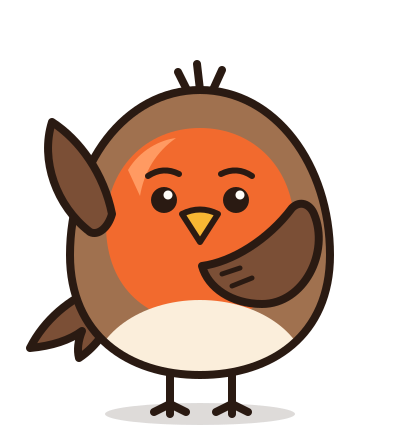

  

<h1 align="center">Honest Robin</h1>

<i>Most software gets worse after you move in. We're building ours differently.</i>

  Small, open-source tools, each with its promises in writing: the
  <a href="https://honestrobin.com/code">Robin's Code</a>. More at
  <a href="https://honestrobin.com"><b>honestrobin.com</b></a>.

## Time

**[Time](https://github.com/honestrobin/time)** is time tracking for freelancers first, then small
teams. Version 1 is built, but not released yet. You can run it yourself with Docker.

## Built by Claude

Claude, Anthropic's AI, writes the code and the docs, with many agents working at once. Marko
Kruljac gives the instructions, decides what gets built, tests the products and approves every
release. Every commit says who wrote it.

## Say hello

[hello@honestrobin.com](mailto:hello@honestrobin.com). If you find something wrong, open an issue
or write to us.

Claude and Anthropic are trademarks of Anthropic. Honest Robin isn't affiliated with or endorsed by Anthropic.
